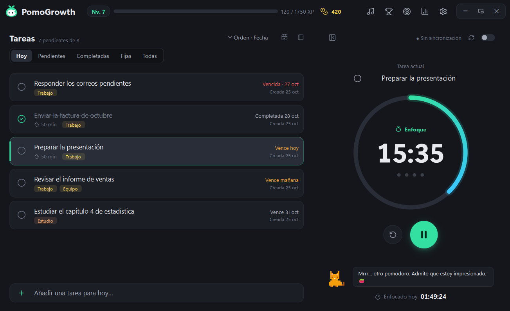
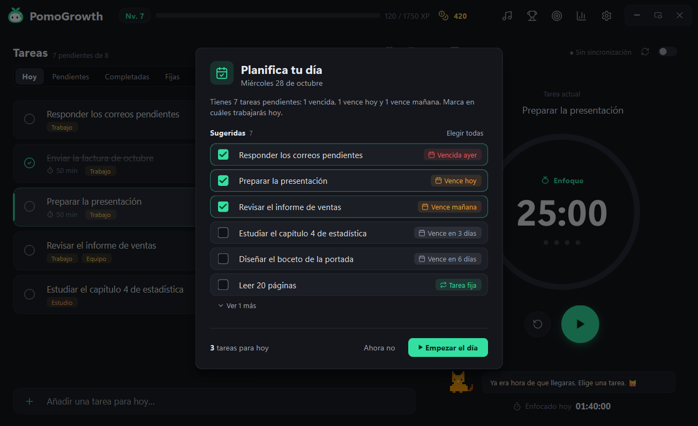

<!-- Cabecera: el logo cambia con el tema de GitHub (claro u oscuro) -->
<div align="center">

<picture>
  <source media="(prefers-color-scheme: dark)" srcset="assets/pomogrowth-horizontal-mono-white.svg">
  <source media="(prefers-color-scheme: light)" srcset="assets/pomogrowth-horizontal-mono-gray.svg">
  
</picture>

**Enfócate por pomodoros, cumple tus tareas y haz crecer tu racha.**

[![Versión 1.0][badge-version]](CHANGELOG.md)
![Windows 10 y 11][badge-windows]
[![Python 3.13][badge-python]](https://www.python.org/)
[![PySide6 · Qt 6][badge-qt]](https://doc.qt.io/qtforpython-6/)
[![Licencia GPL-3.0][badge-license]](LICENSE)

[Características](#características) ·
[Instalación](#instalación) ·
[Desde el código](#desde-el-código) ·
[Privacidad](#privacidad) ·
[Licencia](#licencia) ·
[Hecho por GrowthLab](#hecho-por-growthlab)

</div>

---

## Qué es PomoGrowth

PomoGrowth es una app de escritorio para Windows que junta en una sola ventana
el **temporizador pomodoro** y tu **lista de tareas**, sincronizada con
**Asana**. Cada mañana te propone un **Plan de hoy** según lo que vence, premia
cada pomodoro con **XP, niveles y monedas**, bloquea los sitios que te distraen
con el **modo enfoque**, pone **música** y **sonidos de ambiente** mientras
trabajas y te acompaña con una **mascota pixel** que, si quieres, te da
consejos con IA.

<p align="center">
  
</p>

## Características

- **Temporizador pomodoro**: enfoque, descansos cortos y largos y ciclos a tu
  medida, con anillo de progreso, ventana compacta siempre visible e icono en
  la bandeja del sistema. Si el equipo se suspende, ese rato no cuenta como
  trabajo. Con un pomodoro en pausa, **«Parar»** lo termina ahí: el tiempo
  queda guardado y el ciclo se conserva, pero la XP y las monedas llegan solo
  al completarlo.
- **Modo Libre**: un cronómetro sin límite para concentrarte el tiempo que
  quieras en una tarea; al terminar la sesión con «Parar», a partir de 5
  minutos, suma XP y monedas. «Parar» está en la ventana principal, en la
  compacta y en el menú de la bandeja.
- **Sonidos del temporizador**: avisos propios al acabar cada pomodoro y cada
  descanso, y otros más discretos al iniciar y al pausar. Tres estilos
  (campana, marimba y tonos suaves) o los sonidos del sistema de Windows, con
  interruptor, volumen y botón «Probar» en Configuración.
- **Tareas locales y de Asana**: etiquetas, fechas, notas, tareas fijas
  (diarias, semanales, mensuales o trimestrales) y orden por fecha, proyecto,
  nombre, creación o a mano. Al crear una tarea puedes crearla **también en
  Asana** (en «Mis tareas» o en uno de tus proyectos) **o en ClickUp** con un
  clic en su logo. Los cambios hacia Asana esperan en una cola y llegan aunque
  te quedes sin conexión, y la sincronización puede traer también tus tareas
  sin proyecto.
- **Plan de hoy**: al empezar el día te sugiere en qué trabajar (vencidas, de
  hoy, de mañana, de esta semana, fijas y en curso) y la vista «Hoy» muestra
  solo eso. Te saluda por tu nombre y lleva la cuenta de los días seguidos que
  usas PomoGrowth.
- **Presentación**: en una instalación nueva, tras preguntarte el nombre, tres
  diapositivas animadas te enseñan cómo te ayuda PomoGrowth: enfocarte en una
  tarea, trabajar sin distracciones y ver cómo creces. Puedes volver a verla
  desde Configuración → Timer y ventana → Perfil.
- **Progreso y recompensas**: XP, niveles, monedas y racha diaria; en la tienda
  canjeas temas (Océano, Bosque, Atardecer, Medianoche, Cereza, Matrix y
  Dorado) y mascotas.
- **Mascota pixel con IA**: un gato, un perro o una rata 8-bit que celebra tus
  pomodoros. Con tu clave de Claude o de ChatGPT, o con un modelo propio (por
  ejemplo, uno local con Ollama), te da consejos con IA; sin ninguno, usa sus
  propias frases.
- **Modo enfoque**: bloquea los sitios que te distraen a través del archivo
  hosts de Windows, con un comodín para liberar un sitio solo hasta que cierres
  la app. Si hace falta, se reinicia como administrador con un botón.
- **Música**: trae de serie tres radios lofi gratuitas (24/7 Lofi Radio,
  bigFM LoFi Focus y NIA Radio LoFi), que solo se conectan al reproducirlas, y
  admite tus radios en directo, enlaces y archivos de tu equipo (hasta MP3 a
  320 kbps), con mini reproductor y la opción de que suene solo durante el
  enfoque. Cada radio Icecast o SHOUTcast usa **una sola conexión** con la
  emisora, también para el título de la canción, así que las de pago como
  DI.FM no ven una sesión de más; si una de ellas rechaza la conexión, la
  música se para con un aviso en vez de insistir. Si una radio en directo se
  corta, la siguiente conexión llega con un pequeño búfer (de 5 a 20 s) que
  crece solo cuando hace falta.
- **Sonidos de ambiente**: lluvia, tormenta, océano, río, bosque y chimenea
  (grabaciones reales) y ruido blanco, rosa y marrón, para mezclarlos entre sí
  y con tu música desde el diálogo de Música. Cada sonido lleva su volumen y
  hay uno general; se repiten en bucle con un fundido cruzado, entran y salen
  poco a poco y pueden sonar solo durante el enfoque. Al abrir la app no suena
  nada: «Reanudar» recupera tu última mezcla, y un punto en el botón Música te
  avisa de que hay ambiente activo.
- **Estadísticas**: de hoy al histórico, con gráficos, tablas por proyecto y
  por tarea y exportación a CSV y Excel. Al completar una tarea puedes valorar
  de 1 a 5 estrellas cuánto esfuerzo te costó, y la media sale aquí.
- **Datos a prueba de cortes**: escritura atómica con copia `.bak` y copias de
  seguridad que puedes exportar e importar.

<p align="center">
  
</p>

### Versión 1.0.2

Radios de pago con una sola conexión, botón «Parar» y radios lofi de serie:

- **Una sola conexión con cada radio**: el audio y el título de la canción
  llegan por la misma conexión (antes el título se consultaba aparte cada
  30 s), sin solapes al reconectar ni al cambiar de radio, para que DI.FM y
  otras radios de pago no pausen tu cuenta. Si una de ellas rechaza la
  conexión, la música se para con un aviso que lleva su código en vez de
  insistir; una radio gratuita que no llega a sonar pasa a la siguiente de la
  lista. Las reconexiones van espaciadas, con un tope de 10 conexiones en 10
  minutos.
- **Botón «Parar»** a la derecha del play, en la ventana compacta y en la
  bandeja: termina un pomodoro en pausa (guarda el tiempo, sin XP ni monedas)
  o una sesión del modo Libre, donde sustituye a la bandera «Terminar
  sesión».
- **Tres radios lofi gratuitas de serie** en la lista «Radios lofi», también
  para quien actualiza. Las que quites no vuelven.
- **Ventanas**: «Siempre visible» se recupera solo y su marca en la bandeja
  coincide con Configuración; abrir PomoGrowth con la app ya abierta la trae
  al frente; los avisos no tapan la ventana compacta ni se quedan los clics,
  y los diálogos nunca quedan colgados de una ventana oculta.
- **Diagnóstico**: `logs/pomogrowth_fallos.log` apunta los cierres
  inesperados y las veces que la ventana se queda colgada.

### Versión 1.0

La primera versión pública. Reúne todo lo construido en las versiones internas
(de la 9.0 a la 9.4). Lo último en llegar:

- **Sonidos propios del temporizador**, **sonidos de ambiente** con
  grabaciones reales para mezclar con tu música y una **presentación animada**
  en el primer arranque.
- **Modo Libre**, alta también en **Asana o ClickUp** desde el panel de nueva
  tarea, tus tareas de Asana **sin proyecto**, saludo con tu **nombre**,
  **racha de días** de uso, **valoración de esfuerzo** y **búfer** para las
  radios que se cortan.
- El **modo enfoque** funciona aunque el archivo hosts tenga la marca de solo
  lectura, explica cada fallo por su causa y ofrece **«Reiniciar como
  administrador»**.
- Firma **«Fabricioplus»** al pie de Configuración, a la altura de Cancelar y
  Guardar: abre este proyecto en GitHub.
- La **X** y «Cerrar» de la bandeja preguntan si de verdad quieres salir y
  cierran PomoGrowth por completo.
- La despedida te invita a darle una **estrella** a este repositorio, a
  apoyarnos en **Ko-fi** y a seguirnos en redes: **@xgrowthlab** y
  **@fabricioplus**.

Historial completo en [CHANGELOG.md](CHANGELOG.md).

## Instalación

Necesitas **Windows 10 (1809 o posterior) u 11, de 64 bits**. El instalador y
la versión portable se generan con los pasos de [Compilar](#compilar).

### Con el instalador (recomendado)

1. Ejecuta `PomoGrowth_v1.0.2_instalador.exe` (queda en `dist/` al compilarlo).
2. Se instala solo para tu usuario y **sin permisos de administrador** en
   `%LOCALAPPDATA%\Programs\PomoGrowth`, con acceso en el menú Inicio y, si lo
   marcas, en el escritorio.
3. Tus datos (tareas, progreso y ajustes) se guardan junto al programa: **se
   conservan al actualizar** instalando encima, y al desinstalar se te pregunta
   antes de borrarlos.

### Portable

Descomprime `PomoGrowth_v1.0.2_portable.zip` en una carpeta con permiso de
escritura y abre `PomoGrowth.exe`. Los datos se crean junto al exe, así que
puedes llevarte la carpeta entera. Usa una ruta corta (por ejemplo
`C:\PomoGrowth`): con rutas de más de 260 caracteres Windows no carga algunos
módulos.

> [!NOTE]
> El **modo enfoque** escribe en el archivo hosts de Windows: para usarlo, abre
> PomoGrowth como administrador (o pulsa «Reiniciar como administrador» en su
> ventana). Para recibir tareas desde automatizaciones como n8n, la app
> escucha en el puerto 8081 solo de este equipo (127.0.0.1). Si eliges «Red
> local, con clave» en Configuración → Webhook, Windows te pedirá permiso en el
> firewall la primera vez.

## Desde el código

Requisitos: Windows 10/11 y **Python 3.13**.

```powershell
git clone https://github.com/fabricioplus/pomogrowth.git
cd pomogrowth
python -m venv .venv
.\.venv\Scripts\Activate.ps1
pip install -r requirements.txt
pip install matplotlib openpyxl   # Estadísticas y exportación a Excel
python main.py
```

En desarrollo, los datos se guardan en la raíz del repositorio
(`pomogrowth_data.json`, `user_progress.json`, `focus_config.json` y `logs/`),
que `.gitignore` deja fuera.

Los sonidos del temporizador y los de ambiente ya están en `assets/sounds/`:
no hay que generarlos para ejecutar ni para compilar. Sus scripts solo hacen
falta para rehacerlos, con dependencias que el código de la app no usa:
`scripts/build_sounds.py` (numpy; da siempre los mismos WAV) y
`scripts/build_ambient_sounds.py` (numpy, scipy y soundfile; descarga las
grabaciones originales y comprueba su SHA-1).

### Tests

```powershell
pip install pytest pytest-qt numpy
$env:QT_QPA_PLATFORM = "offscreen"; python -m pytest tests -q
```

Trabajan con datos de prueba en carpetas temporales, en silencio, sin tocar el
archivo hosts real y sin salir a internet: una guarda de red hace fallar el
test que lo intente, las radios de serie no se siembran y las pruebas de radio
usan servidores falsos en 127.0.0.1 (entre ellos una emisora Icecast,
`tests/fakes/icecast.py`).
`tests/test_timer_sounds.py` necesita numpy: comprueba que los WAV del
repositorio son justo los que genera `scripts/build_sounds.py`. Algunas
pruebas se saltan solas si el entorno no las permite: las de ventanas Win32
reales, si Windows no deja poner una ventana «encima de todo» en ese momento,
y las de radios https, si tu Python no trae los certificados de prueba de
`Lib/test`.
`tests/test_core_parity.py` va aparte: compara el motor con la v8 y necesita su
carpeta.

### Compilar

```powershell
pip install pyinstaller
python scripts/build_brand_assets.py   # solo si cambia la mascota (assets/icono.svg)
python -m PyInstaller PomoGrowth.spec --noconfirm --distpath build/release --workpath build/work
ISCC.exe installer\PomoGrowth.iss      # Inno Setup 6.6+ → dist\PomoGrowth_v1.0.2_instalador.exe
```

- El build queda en `build/release/PomoGrowth/` (`PomoGrowth.exe` +
  `_internal/`) y sin datos. `python scripts/make_portable.py` la comprime en
  `dist\PomoGrowth_v1.0.2_portable.zip` (la versión portable) y se niega si junto
  al exe hay datos, por ejemplo si lo abriste para probarlo.
- **Nunca compiles con la salida en `dist/`**: PyInstaller vacía la carpeta de
  salida entera y en `dist/` puede haber una instalación con datos reales. El
  spec se niega a compilar sobre una carpeta con datos.
- El instalador solo se compila con un build de su misma versión
  (`Config.APP_VERSION` en `core/config.py`, igual que `AppVersion` en el
  `.iss`). Si `ISCC.exe` no está en el PATH, usa su ruta completa.

## Estructura del proyecto

```text
pomogrowth/
├── main.py             # Punto de entrada
├── core/               # Motor sin Qt: datos, Asana, pomodoro, Plan de hoy, recompensas, enfoque
├── services/           # Puentes con Qt: Asana, música, ambiente, mascota IA, webhook, sonidos
├── ui/                 # Ventanas, widgets, diálogos, tema y el AppController
├── utils/              # JSON atómico, logs, rutas y Win32
├── assets/             # Iconos, marca (SVG) y carpeta de música lofi
│   └── sounds/         # Avisos del temporizador (WAV) y ambiente (OGG, con CREDITOS.txt)
├── tests/              # pytest + pytest-qt
├── scripts/            # Capturas de humo, iconos de marca, portable y sonidos
├── shots/              # Sprites de las mascotas (las capturas de humo no se versionan)
├── installer/          # Instalador de Inno Setup
├── docs/               # Capturas de este README
├── PomoGrowth.spec     # Build de PyInstaller (onedir)
├── DOCUMENTACION.md    # Arquitectura y referencia técnica
└── CHANGELOG.md        # Historial de versiones
```

Tres capas con dependencias en un solo sentido (`ui → services → core`). La
arquitectura, los módulos y el esquema de datos están en
[DOCUMENTACION.md](DOCUMENTACION.md); los cambios de cada versión, en
[CHANGELOG.md](CHANGELOG.md).

## Privacidad

- Todo se guarda **solo en tu equipo**, junto al exe (o en la raíz del
  repositorio, en desarrollo): tareas, progreso, ajustes, el token de Asana y
  las claves de IA. No hay servidor propio ni cuentas de PomoGrowth.
- Esos archivos **nunca se versionan** (`.gitignore`) y el instalador nunca los
  incluye ni los sobrescribe.
- La app solo se conecta a lo que configures: Asana, la IA que elijas para la
  mascota (Claude, ChatGPT o tu propio servidor) y solo cuando le pides un
  consejo, las integraciones opcionales, las radios o enlaces de música que
  añadas y las tres radios lofi de serie, estas solo cuando las reproduces.
  Las radios Icecast y SHOUTcast suenan a través de un pequeño servidor local
  (127.0.0.1) que solo atiende a tu equipo y es la única conexión con la
  emisora.
- Los registros de diagnóstico (`logs/`, también `pomogrowth_fallos.log`) se
  quedan en tu equipo: no se envían a ningún sitio.
- Los tokens se guardan en texto plano: no compartas la carpeta de PomoGrowth
  ni copias de ella.

## Licencia

PomoGrowth es **software libre**: puedes usarlo, estudiarlo, compartirlo y
modificarlo bajo la **GNU General Public License, versión 3 o posterior**
(GPL-3.0-or-later). El texto completo está en [LICENSE](LICENSE), y el
instalador y la versión portable lo incluyen como `LICENSE.txt`.

- Si distribuyes PomoGrowth, o una versión modificada, ha de ser también bajo
  la GPL y con su código fuente.
- La licencia cubre el código, no la marca: el nombre «PomoGrowth», su mascota
  y su logotipo son de GrowthLab (GPL-3.0, sección 7). Si publicas una versión
  modificada, usa otro nombre y otro logotipo para que no se confunda con la
  oficial.
- Los iconos de Lucide (ISC) y los logotipos de Simple Icons (CC0) conservan
  sus licencias: ver `assets/icons/LICENSE-*.txt`.
- Las grabaciones de los sonidos de ambiente son de dominio público o CC0
  (de Wikimedia Commons y Freesound); los ruidos blanco, rosa y marrón están
  sintetizados y van bajo la licencia de la app. Los autores, las fuentes y
  los tramos usados están en
  [assets/sounds/ambient/CREDITOS.txt](assets/sounds/ambient/CREDITOS.txt),
  que se empaqueta con los audios.

## Hecho por GrowthLab

<div align="center">

PomoGrowth es un proyecto de **[GrowthLab](https://growthlab.pe)**,<br>
diseñado y desarrollado por **Fabricio S.** ([@fabricioplus](https://github.com/fabricioplus)).

PomoGrowth es gratis, y su versión Comunidad, la que funciona en tu equipo, lo
será siempre. Si te ayuda en tu día a día, puedes invitarnos un café:

[![Apóyanos en Ko-fi][badge-kofi]](https://ko-fi.com/L3Q421O7ZW)

¿Disfrutas de PomoGrowth? Ayúdanos también siguiéndonos en nuestras redes.

<!-- Redes verificadas en growthlab.pe: Facebook, Instagram y LinkedIn de
     @xgrowthlab y el LinkedIn de @fabricioplus; el resto sigue el mismo
     usuario. Los mismos enlaces que Config.SOCIAL_LINKS (core/config.py) -->

**GrowthLab** · `@xgrowthlab`

[![Facebook][badge-facebook]][xgrowthlab-facebook]
[![Instagram][badge-instagram]][xgrowthlab-instagram]
[![YouTube][badge-youtube]][xgrowthlab-youtube]
[![TikTok][badge-tiktok]][xgrowthlab-tiktok]
[![LinkedIn][badge-linkedin]][xgrowthlab-linkedin]
[![Web growthlab.pe][badge-web]](https://growthlab.pe)

**Fabricio S.** · `@fabricioplus`

[![GitHub][badge-github]][fabricioplus-github]
[![Facebook][badge-facebook]][fabricioplus-facebook]
[![Instagram][badge-instagram]][fabricioplus-instagram]
[![YouTube][badge-youtube]][fabricioplus-youtube]
[![TikTok][badge-tiktok]][fabricioplus-tiktok]
[![LinkedIn][badge-linkedin]][fabricioplus-linkedin]

</div>

---

<p align="center">
  <sub>Iconos de <a href="https://lucide.dev">Lucide</a> y logotipos de
  <a href="https://simpleicons.org">Simple Icons</a>; cada marca pertenece a su
  dueño.</sub><br>
  <sub>Grabaciones de ambiente de Wikimedia Commons y Freesound: autores en
  <a href="assets/sounds/ambient/CREDITOS.txt">CREDITOS.txt</a>.</sub><br>
  <sub>© 2026 GrowthLab · Fabricio S. Software libre bajo la licencia
  <a href="LICENSE">GPL-3.0-or-later</a>.</sub>
</p>

<!-- Insignias (shields.io). LinkedIn ya no está entre los logos de Simple
     Icons que usa shields.io: va como SVG propio (trazado de Simple Icons, CC0) -->
[badge-version]: https://img.shields.io/badge/versi%C3%B3n-1.0-0BBF85?style=flat-square
[badge-kofi]: https://img.shields.io/badge/Ap%C3%B3yanos%20en-Ko--fi-0BBF85?style=flat-square&logo=kofi&logoColor=white
[badge-license]: https://img.shields.io/badge/licencia-GPL--3.0-0BBF85?style=flat-square
[badge-windows]: https://img.shields.io/badge/Windows-10%20%7C%2011-0078D4?style=flat-square
[badge-python]: https://img.shields.io/badge/Python-3.13-3776AB?style=flat-square&logo=python&logoColor=white
[badge-qt]: https://img.shields.io/badge/PySide6-Qt%206-41CD52?style=flat-square&logo=qt&logoColor=white
[badge-facebook]: https://img.shields.io/badge/Facebook-1877F2?style=flat-square&logo=facebook&logoColor=white
[badge-instagram]: https://img.shields.io/badge/Instagram-E4405F?style=flat-square&logo=instagram&logoColor=white
[badge-youtube]: https://img.shields.io/badge/YouTube-FF0000?style=flat-square&logo=youtube&logoColor=white
[badge-tiktok]: https://img.shields.io/badge/TikTok-000000?style=flat-square&logo=tiktok&logoColor=white
[badge-linkedin]: https://img.shields.io/badge/LinkedIn-0A66C2?style=flat-square&logo=data%3Aimage%2Fsvg%2Bxml%3Bbase64%2CPHN2ZyB4bWxucz0iaHR0cDovL3d3dy53My5vcmcvMjAwMC9zdmciIHZpZXdCb3g9IjAgMCAyNCAyNCI%2BPHBhdGggZmlsbD0iI2ZmZiIgZD0iTTIwLjQ0NyAyMC40NTJoLTMuNTU0di01LjU2OWMwLTEuMzI4LS4wMjctMy4wMzctMS44NTItMy4wMzctMS44NTMgMC0yLjEzNiAxLjQ0NS0yLjEzNiAyLjkzOXY1LjY2N0g5LjM1MVY5aDMuNDE0djEuNTYxaC4wNDZjLjQ3Ny0uOSAxLjYzNy0xLjg1IDMuMzctMS44NSAzLjYwMSAwIDQuMjY3IDIuMzcgNC4yNjcgNS40NTV2Ni4yODZ6TTUuMzM3IDcuNDMzYy0xLjE0NCAwLTIuMDYzLS45MjYtMi4wNjMtMi4wNjUgMC0xLjEzOC45Mi0yLjA2MyAyLjA2My0yLjA2MyAxLjE0IDAgMi4wNjQuOTI1IDIuMDY0IDIuMDYzIDAgMS4xMzktLjkyNSAyLjA2NS0yLjA2NCAyLjA2NXptMS43ODIgMTMuMDE5SDMuNTU1VjloMy41NjR2MTEuNDUyek0yMi4yMjUgMEgxLjc3MUMuNzkyIDAgMCAuNzc0IDAgMS43Mjl2MjAuNTQyQzAgMjMuMjI3Ljc5MiAyNCAxLjc3MSAyNGgyMC40NTFDMjMuMiAyNCAyNCAyMy4yMjcgMjQgMjIuMjcxVjEuNzI5QzI0IC43NzQgMjMuMiAwIDIyLjIyMiAwaC4wMDN6Ii8%2BPC9zdmc%2B
[badge-github]: https://img.shields.io/badge/GitHub-181717?style=flat-square&logo=github&logoColor=white
[badge-web]: https://img.shields.io/badge/growthlab.pe-0BBF85?style=flat-square

<!-- Perfiles -->
[xgrowthlab-facebook]: https://facebook.com/xgrowthlab
[xgrowthlab-instagram]: https://instagram.com/xgrowthlab
[xgrowthlab-youtube]: https://youtube.com/@xgrowthlab
[xgrowthlab-tiktok]: https://tiktok.com/@xgrowthlab
[xgrowthlab-linkedin]: https://linkedin.com/company/growthlabpe
[fabricioplus-github]: https://github.com/fabricioplus
[fabricioplus-facebook]: https://facebook.com/fabricioplus
[fabricioplus-instagram]: https://instagram.com/fabricioplus
[fabricioplus-youtube]: https://youtube.com/@fabricioplus
[fabricioplus-tiktok]: https://tiktok.com/@fabricioplus
[fabricioplus-linkedin]: https://linkedin.com/in/fabricioplus
